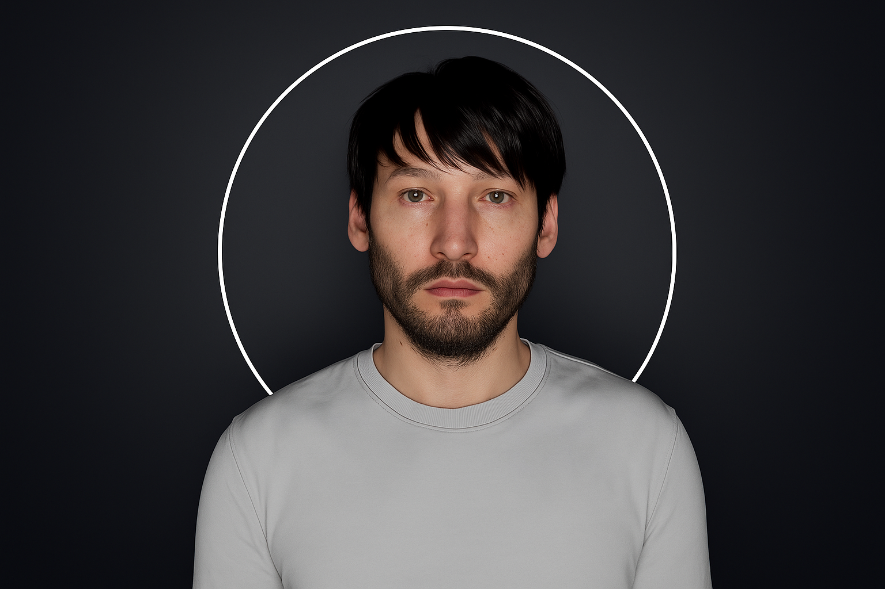
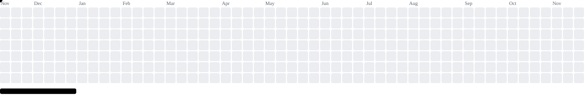
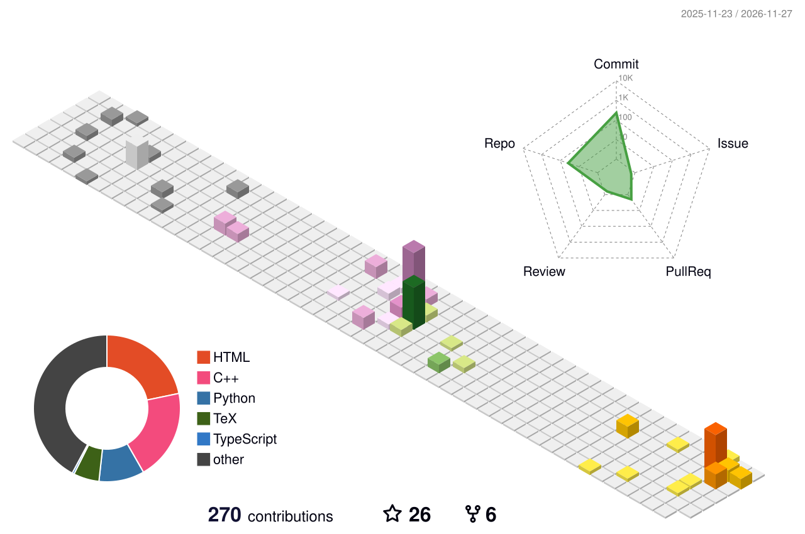

<p align="center">
  <a href="https://urumarrazzaq.github.io/">
    
  </a>
</p>

<p align="center">
  <a href="https://urumarrazzaq.github.io/"></a>
  <a href="https://youtu.be/deM89YjD4g0"></a>
  <a href="https://linktr.ee/urumarrazzaq"></a>
</p>

---

## 🕹️ Player 1 has entered the game

> *Building with logic, dreaming in color. Developer by profession, artist by heart.*

```cpp
UCLASS()
class AUmarRazzaq : public AUnrealEngineDeveloper
{
    GENERATED_BODY()

public:
    UPROPERTY(EditAnywhere) FString Role      = TEXT("Unreal Engine 5 Specialist");
    UPROPERTY(EditAnywhere) TArray<FString> Skills = {
        TEXT("Gameplay C++ & Blueprints"), TEXT("Game AI"),
        TEXT("Multiplayer & Replication"), TEXT("UI/UX with UMG"), TEXT("ArchViz") };
    UPROPERTY(EditAnywhere) FString Mission   = TEXT("Craft immersive, high-quality interactive experiences");

    virtual void BeginPlay() override { Super::BeginPlay(); ShipSomethingAwesome(); }
};
```

## 🎥 Intro cutscene

<p align="center">
  <a href="https://youtu.be/deM89YjD4g0">
    
  </a>
</p>

## ⚔️ Skill tree

| | Ability | What it unlocks |
|:-:|---|---|
| 🚀 | **Gameplay Programming** | Responsive mechanics in C++ and Blueprints |
| 🤖 | **AI Development** | Smart AI with adaptive behaviour and decision-making |
| 🌐 | **Multiplayer** | Networked gameplay and replication in UE5 |
| 🎨 | **UI/UX** | Smooth, interactive interfaces with UMG |
| 🏗️ | **ArchViz & Environments** | Realistic worlds in Unreal Engine 5 |

<p align="center">
  
</p>

## 🏆 Quest log - featured projects

| Project | What it does |
|---|---|
| 🧰 **[Claude UE5 Dev Toolkit](https://github.com/urumarrazzaq/claude-ue5-dev-toolkit)** | Claude Code toolkit for Unreal Engine 5: UE-specific skills, specialised subagents, a safety hook that blocks destructive commands, and a project validator |
| 🃏 **Poker AI System** | Advanced AI with randomized behaviour, adaptive strategies and bluffing |
| 👀 **Paranoid Look-Back System** | Dynamic player animations and camera effects for horror games |
| 🔫 **Multiplayer FPS Module** | Custom shooting mechanics and networking in UE5 |

<p align="center">
  <a href="https://urumarrazzaq.github.io/"><b>🌐 Full portfolio</b></a> &nbsp;•&nbsp;
  <a href="https://github.com/urumarrazzaq?tab=repositories"><b>📦 All repositories</b></a>
</p>

## 👾 Arcade - my contributions, played as games

*Every square is a day of code. The games regenerate daily from my contribution graph.*

<picture>
  <source media="(prefers-color-scheme: dark)" srcset="https://raw.githubusercontent.com/urumarrazzaq/urumarrazzaq/output/snake-dark.svg" />
  <source media="(prefers-color-scheme: light)" srcset="https://raw.githubusercontent.com/urumarrazzaq/urumarrazzaq/output/snake.svg" />
  
</picture>

<picture>
  <source media="(prefers-color-scheme: dark)" srcset="https://raw.githubusercontent.com/urumarrazzaq/urumarrazzaq/output/pacman-contribution-graph-dark.svg" />
  <source media="(prefers-color-scheme: light)" srcset="https://raw.githubusercontent.com/urumarrazzaq/urumarrazzaq/output/pacman-contribution-graph.svg" />
  
</picture>

<details>
<summary><b>🪙 Insert coin for more games - Galaga, Breakout, Puzzle Bobble, Bomberman</b></summary>

<br />

**🚀 Galaga**

<picture>
  <source media="(prefers-color-scheme: dark)" srcset="https://raw.githubusercontent.com/urumarrazzaq/urumarrazzaq/output/galaga-contribution-graph-dark.svg" />
  <source media="(prefers-color-scheme: light)" srcset="https://raw.githubusercontent.com/urumarrazzaq/urumarrazzaq/output/galaga-contribution-graph.svg" />
  
</picture>

**🧱 Breakout**

<picture>
  <source media="(prefers-color-scheme: dark)" srcset="https://raw.githubusercontent.com/urumarrazzaq/urumarrazzaq/output/breakout-contribution-graph-dark.svg" />
  <source media="(prefers-color-scheme: light)" srcset="https://raw.githubusercontent.com/urumarrazzaq/urumarrazzaq/output/breakout-contribution-graph.svg" />
  
</picture>

**🫧 Puzzle Bobble**

<picture>
  <source media="(prefers-color-scheme: dark)" srcset="https://raw.githubusercontent.com/urumarrazzaq/urumarrazzaq/output/puzzle-bobble-contribution-graph-dark.svg" />
  <source media="(prefers-color-scheme: light)" srcset="https://raw.githubusercontent.com/urumarrazzaq/urumarrazzaq/output/puzzle-bobble-contribution-graph.svg" />
  
</picture>

**💣 Bomberman**

<picture>
  <source media="(prefers-color-scheme: dark)" srcset="https://raw.githubusercontent.com/urumarrazzaq/urumarrazzaq/output/bomberman-contribution-graph-dark.svg" />
  <source media="(prefers-color-scheme: light)" srcset="https://raw.githubusercontent.com/urumarrazzaq/urumarrazzaq/output/bomberman-contribution-graph.svg" />
  
</picture>

</details>

## 🏙️ Contribution city

<picture>
  <source media="(prefers-color-scheme: dark)" srcset="https://raw.githubusercontent.com/urumarrazzaq/urumarrazzaq/output/profile-3d-contrib/profile-night-rainbow.svg" />
  <source media="(prefers-color-scheme: light)" srcset="https://raw.githubusercontent.com/urumarrazzaq/urumarrazzaq/output/profile-3d-contrib/profile-season-animate.svg" />
  
</picture>

<p align="center">
  
</p>

## ⚡ Loading screen tip

> 💡 Unreal Engine was originally built for first-person shooters - today it powers films, virtual production and architectural visualization. 🎬🏡

## 📫 Co-op mode

Got a game, a prototype or a crazy AI idea? Let's build it.

<p align="center">
  <a href="https://youtu.be/deM89YjD4g0"></a>
  <a href="https://linktr.ee/urumarrazzaq"></a>
</p>


